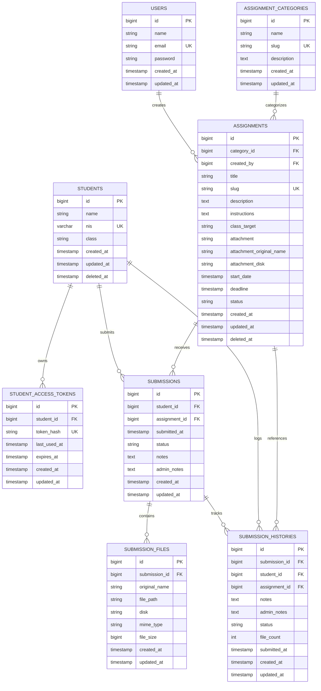

# Database ERD & Schema Design

The database is designed for **PostgreSQL (Neon)** and is 100% compatible with standard ANSI SQL (also runnable on MySQL 8 for local setups). All timestamps are stored in UTC.

## Entity Relationship Diagram

## Key Database Rules
- **Unique NIS**: `students.nis` is `VARCHAR(50)` with a unique index.
- **One Active Submission per Student/Assignment**: Composite unique constraint `(student_id, assignment_id)` on `submissions`.
- **Safe Deletion**: `assignments` and `students` use `softDeletes`; `submissions` uses `restrictOnDelete` so historical submissions are never accidentally wiped.
- **No Binary Storage in DB**: `submission_files` stores only metadata (`original_name`, UUID `file_path`, `disk`, `mime_type`, `file_size`).
- **Dynamic Timeliness**: Late status is derived from `submissions.submitted_at > assignments.deadline` rather than stored as a review status.
- **Dashboard Denominator Policy**: For each published assignment, target students are all active (non-deleted) students whose `class` matches `class_target` (`10`, `11`, or `all`).
